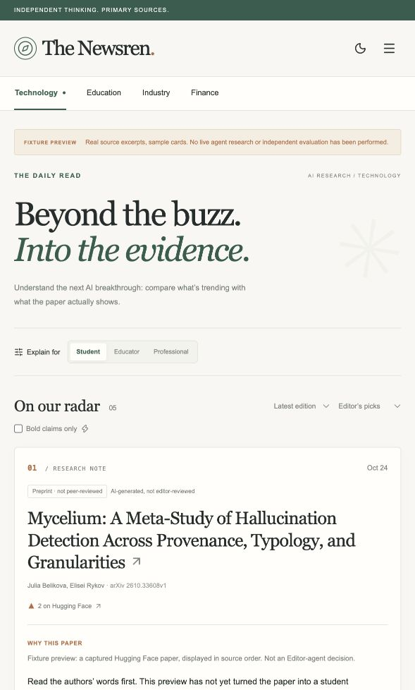
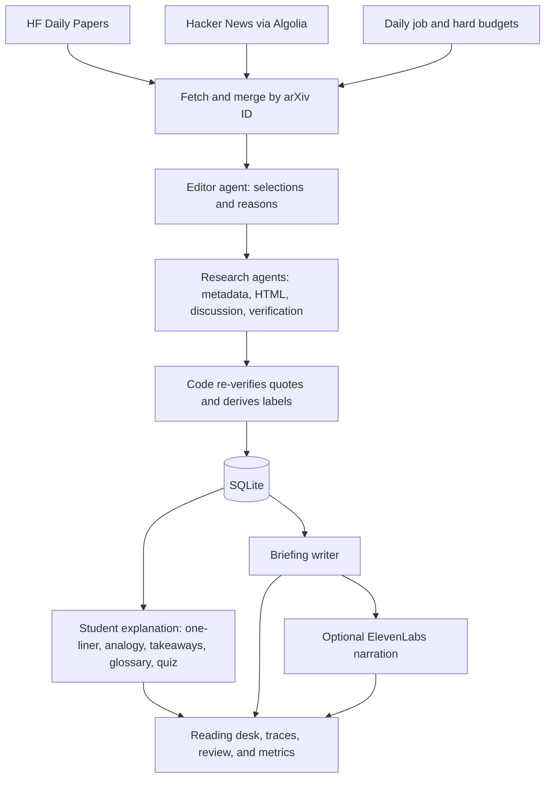

# The Newsren

**An agentic AI research briefing. What everyone’s talking about vs. what the paper actually shows.**

The Newsren follows attention signals from Hugging Face Daily Papers and Hacker News back to arXiv. An Editor chooses papers within a budget. A Research agent gathers primary-source evidence, proposes claims, and checks their quotations. The reading desk shows the evidence, uncertainty, provenance, audience explanations, and the recorded research process.

## Run locally

Requires Node.js **22 LTS or newer**, npm, and a current Codex CLI signed in with ChatGPT. This is a local, single-user Next.js app with SQLite, not a serverless deployment.

```bash
cd /Users/ankojh/b12/ai-news
npm install
# A filled .env has been created in this checkout. For a fresh clone:
cp -n .env.example .env
codex login
npm run db:migrate
npm run dev
```

Open the Local URL printed by Next.js, normally http://127.0.0.1:3000/technology.

The interface opens without provider keys. Live agents use **local OpenAI Codex through your saved ChatGPT subscription sign-in**, not a Platform API key. The app runs `codex exec` in an isolated temporary directory, forces ChatGPT authentication, strips API keys from the child environment, and disables native shell, browser, apps, plugins, hooks, and other agent capabilities. Only the application's validated research tools execute. Existing Codex sign-in is reused; do not copy login credentials into `.env`.

| Agent    | Default model | Job                                          |
| -------- | ------------- | -------------------------------------------- |
| Editor   | `gpt-6-sol`   | Select papers and explain each choice        |
| Research | `gpt-6-sol`   | Gather evidence, verify quotes, submit cards |
| Explain  | `gpt-6-luna`  | Produce the student explanation              |
| Briefing | `gpt-6-luna`  | Write the daily briefing                     |

Set `CODEX_BIN` if the CLI is outside the server's PATH. This machine's `.env` fills its detected absolute path. Model names and reasoning effort are configurable. Subscription usage follows your plan's limits; it is not unlimited and is not converted into invented API dollar prices. Direct OpenAI Platform API billing is separate and is not used by this adapter.

The three research sources need **no keys for their public reads**. Optional `HF_TOKEN` is supported only for Hugging Face requests. See [API setup](docs/API-SETUP.md).

```bash
# Full run, with at most three deep dives
npm run daily -- --limit 3 --no-audio

# Collection + real Editor selection only; this still uses the model
npm run daily -- --dry-run --limit 3

# Collect sources for a particular edition
npm run daily -- --date 2026-10-27 --limit 2
```

The same pipeline is available through **Agent runs → Run now**. One active run blocks another, including across processes. An expired lock is recovered after the run timeout and a one-minute grace period. Keep the long-lived local server running for background jobs.

### Offline interface preview

```bash
npm run demo
npm run dev
```

`demo` creates five sample cards from **real captured HF/arXiv metadata**. It checks short abstract excerpts with the production verifier. It does **not** call an LLM, simulate an Editor decision, infer research findings, or claim an independent evaluation. Every page carries a fixture-preview banner, the run is labeled `fixture-preview`, and its token counts are zero. The command is idempotent and does not overwrite existing cards. Use a separate `DATABASE_PATH` for an isolated preview database.

This checkout was verified with that preview. A full daily agent-research run and ElevenLabs narration remain **unverified**; the local subscription adapter is tested separately from those end-to-end workflows. The fixture preview does not satisfy the live-research acceptance criteria in the handoff.

### Optional audio

Set `ELEVENLABS_API_KEY`, `ELEVENLABS_VOICE_ID`, `ELEVENLABS_MODEL_ID`, and your account’s `PRICE_TTS_PER_1K_CHARS`. Audio is generated once by the run, capped at `MAX_TTS_CHARS`, and stored locally. Missing configuration or a TTS failure leaves the text briefing available and the audio player hidden. The player attributes ElevenLabs. Paid TTS requests are not automatically retried.

### Administration and review

- In development, local admin actions work without a token.
- With `npm run build && npm start`, set `ADMIN_TOKEN` and enter it in **Preferences → Newsroom access**. The browser keeps it only in memory. It protects run triggers, review, settings writes, and human spot-check actions.
- `personal` mode shows draft cards with “AI-generated, not editor-reviewed.”
- `required` mode exposes only approved cards in the feed, paper endpoint, and briefing. A briefing is withheld if any linked card later becomes hidden or requires approval. Approve cards, then run again to prepare a briefing using the approved cards; same-version research is reused.
- Review timing starts when a reviewer opens a card’s evidence, and is recorded with the review decision.
- Topics, review mode, briefing audience, and paper count persist in SQLite. Environment values supply initial defaults. The hard environment paper limit remains an upper bound.

## The reading desk

Technology is the populated vertical. Education and Industry describe planned capabilities. Finance remains an empty state with its informational-only notice. The feed supports edition dates, editorial/most-discussed/newest sorting, and a bold-claims filter. The audience switch persists locally and changes cached explanations instantly.

Each researched card includes labels, signals, the Editor’s reason, verified claims and source quotes, uncertainty, discussion separated from findings, sources and timestamps, and “How this card was made.” Full-text sections stay on the server. Briefings, feedback, review, run detail, settings, metrics, and human spot-checks have persistent API-backed interactions.

**Interface screenshot (fixture preview, not a live researched edition):**



Add a live-edition screenshot and walkthrough GIF after configuring the providers.

## Architecture



A fixed pipeline handles collection and storage. An Editor agent decides what deserves research within a hard budget, and a Research agent with tools decides what evidence to gather for each paper, checks every claim against the source, and reports what it couldn’t verify. Every step is recorded and shown as “How this card was made.”

The application tool-use loop validates every requested tool with Zod and returns repairable failures to the Codex planner. A successful terminal submission ends the loop. Each Codex turn returns a structured JSON plan; Node executes only the allowed application handlers, preserving quote receipts, post-verification, trace persistence, and source-host restrictions. Native Codex tool activity is rejected. CLI sessions are ephemeral and get a minimal environment without application or API keys.

Tool-call caps and wall-clock deadlines are enforced in code. Codex reports token usage after each response, so per-agent and run token caps are checked **between responses**; an in-flight response can exceed the remaining allowance. The app rejects that result and starts no new work. Subscription quotas are additionally enforced by OpenAI. Unlike direct API token counting, the CLI does not provide a pre-request exact token reservation. `MAX_COST_USD_PER_RUN` therefore applies only to separately billed external APIs such as optional narration. Run records identify subscription billing; model steps record tokens with no fabricated dollar cost. TTS still reserves its known charge before the request.

Collection failures and individual research failures are logged without discarding successful cards. Existing cards are reused only for the same arXiv ID and version. Research failures produce failed records, which are excluded from the feed. Drafts with no surviving claims carry a low-evidence label and have their decoder summary cleared.

## What “verified” means

1. **Faithfulness:** does the paper actually say it? → _Checked: every claim’s quote is matched word for word against the paper._
2. **Provenance:** who says it, where, and when? → _Shown: author-reported, preprint vs. published, dates._
3. **Corroboration:** has anyone independent confirmed it? → _Not yet: shown as “Not yet independently confirmed”. On the roadmap._

The verifier rejects quotes outside 6–60 words, ellipses, bracket edits, paraphrases, unavailable sections, and unmatched text. It normalizes Unicode, typography, whitespace, line-break hyphenation, and a narrow set of LaTeX forms. It performs **no fuzzy matching**. Research submissions need successful verification-tool receipts; code then re-verifies independently before storage. Reader queries always include `verified = 1` for claims. Discussion quotes are checked against their specific comments.

Text matching establishes that a quotation occurs in a source. It does **not** establish that a paraphrased claim follows logically from that quote, that every generated decoder sentence is correct, or that a study’s result is true. Human review and spot-checks address those gaps. Explanations and briefings receive only stored cards and verified claims, never raw papers; an additional check rejects new numerical facts. This check is not a semantic proof of an explanation.

## Guardrails and source handling

- Network tools allow only `huggingface.co`, `hn.algolia.com`, `export.arxiv.org`, `arxiv.org`, and `api.elevenlabs.io`. The local Codex runtime authenticates with OpenAI using its saved ChatGPT sign-in. Redirects, alternative ports, embedded credentials, and all other source hosts are rejected.
- Source operations use HTTPS, bounded retries for reads, timeouts, and a disk cache. All arXiv requests share a process-wide one-request-per-three-seconds queue. Immutable versioned text is cached for seven days; latest metadata and attention signals refresh after thirty minutes.
- Tool outputs are explicitly untrusted data in every prompt. Agents cannot browse arbitrary URLs, post, email, or perform financial or educational decisions. Reader text is React-escaped.
- Only modern arXiv IDs are supported. Metadata and abstracts may be stored and displayed. Full paper HTML is cached for verification and never served to readers. A missing HTML version means abstract-only research; there is no PDF fallback.
- Distributed arXiv HTML and HN parser fixtures contain **short real excerpts**, not full papers or complete discussions. Metadata fixtures include their capture provenance. `npm run capture-fixtures` refreshes them from approved sources.
- Production mutations use bearer authentication, input validation, and same-origin checks. Audio filenames are restricted and must belong to a currently visible briefing. This is a localhost MVP, not a hardened multi-user service.
- No secrets are committed. SQLite, cached source text, audio, and `.env` are gitignored.

## Verification performed

```bash
npm run typecheck
npm test
npm run lint
npm run build
npm run metrics
```

The tests cover quote normalization and rejection, section boundaries, current real-source fixture parsing, table extraction, modern arXiv URL validation, signal merging and version reuse, publication and boldness labels, source allowlisting, token/tool/time caps, external-spend reservations, loop warnings and repair, defense-in-depth drops, query visibility, briefing invalidation, review actions, correction counters, admin access, cross-origin mutations, audio traversal rejection, and human spot-check persistence.

The browser preview was checked for feed rendering, audience switching, evidence expansion, and the Finance notice. The Codex transport was smoke-tested successfully with the account-available `gpt-6-sol` and `gpt-6-luna` models using saved ChatGPT sign-in; no Platform API key was used. The complete daily research workflow and audio generation remain untested. A full live run consumes Codex plan usage; audio additionally requires an ElevenLabs key and account-specific pricing.

## Metrics and findings

Observed **offline fixture-preview** results (not an agent evaluation):

| Measurement                                    | Observed value |
| ---------------------------------------------- | -------------: |
| Sample cards                                   |              5 |
| Source excerpts passing exact quote checks     |          5 / 5 |
| LLM input / output tokens                      |          0 / 0 |
| Paid API generation calls                      |              0 |
| Human support spot-check                       |   Not measured |
| Editorial review time                          |   Not measured |
| Live-run cost                                  |   Not measured |
| Scientific accuracy / independent confirmation |  Not evaluated |

These observations validate the preview’s text-matching and presentation path. They do not establish the quality of agent research. Run `npm run metrics` after a real edition and human spot-check, then replace or extend this table with the observed results. The app measures quote pass rate, corrections, card/briefing usefulness votes, review and research time, tool usage, run costs, per-card tokens and costs, briefing model costs, bold-claim coverage, HTML availability, and community concerns. Education and return engagement are explicitly “Not measured in MVP.”

## Mapping to the plan

| Plan capability                               | Implementation                                                                    |
| --------------------------------------------- | --------------------------------------------------------------------------------- |
| Approved-source discovery and ingestion       | HF + HN + batched arXiv metadata + arXiv HTML, validation, cache, rate limit      |
| Source merging                                | Canonical arXiv ID, latest version, combined signals, reusable cards              |
| Agentic editorial judgment                    | Editor tools, selection validation, priorities, reasons, recorded trace           |
| Research Paper Decoder / Launch Reality Check | Research tools, claims and quote receipts, post-verification, labels, uncertainty |
| Full provenance                               | Source URLs, paper versions, timestamps, source locations, tool trace             |
| News-to-Learning                              | Student explanation: one-liner, analogy, takeaways, glossary, quick-check quiz    |
| Category navigation                           | AI & Technology only; other verticals removed from this version                   |
| Briefings                                     | Text + optional ElevenLabs audio; live output not yet exercised                   |
| Editorial quality gate                        | Personal / required modes, approve / hide, measured review time                   |
| Trust and usefulness                          | Feedback, correction flags, human spot-checks, actual usage/cost ledger           |
| Settings                                      | Topics, paper limit, review mode, briefing audience                               |
| Ask about a paper                             | P2, not implemented; endpoint reports roadmap status                              |
| Independent evidence inspection               | Partial: source faithfulness/provenance; corroboration is roadmap                 |
| End-to-end live acceptance                    | Pending credentials and a live evaluation; fixture preview is separate            |

## Limitations and roadmap

The feed reflects attention, not importance: quiet but important papers can be missed, and trending papers skew toward bold claims. HN comments are opinions. Abstract-only cards cannot inspect methods and tables. Matching text is faithfulness, not independent corroboration. No live evaluation findings are claimed by this implementation.

Roadmap: paper Q&A with verified citations; follow a topic and detect changes; connected-story timelines and the Technology Evolution Timeline; a claim ledger with independent Semantic Scholar/leaderboard corroboration; Industry Impact analysis; broader evidence/bias inspection; more signals (Bluesky, Reddit, X using authorized APIs); opt-in email briefings; multi-user accounts; Education, Industry, and Finance with the plan’s guardrails; Postgres/pgvector; deployment; mobile applications. No social posting, financial recommendations, or autonomous educational decisions are included.

Positioning: free daily briefings and explainers for students and young professionals; later, paid advanced monitoring, team workspaces, and exportable reports.

The source handoff assumes a standalone local app. No course-provided prototype or source PDF was available; `HANDOFF.md` is the original implementation reference; the owner subsequently requested replacing Claude with local OpenAI Codex subscription agents. The original unusually named `HANDOF≈F.md` is preserved in the repository.

## References and credits

- [OpenAI Codex authentication](https://learn.chatgpt.com/docs/auth), [non-interactive mode](https://developers.openai.com/codex/noninteractive), and [available models](https://learn.chatgpt.com/docs/models). Local subscription authentication is distinct from separately billed OpenAI Platform API usage.
- [ElevenLabs text-to-speech API](https://elevenlabs.io/docs/api-reference/text-to-speech/convert) and [model listing](https://elevenlabs.io/docs/api-reference/models/list). Narration requires the account’s applicable licensing and attribution terms.
- [Next.js documentation](https://nextjs.org/docs/app), TypeScript, React, Tailwind CSS, better-sqlite3, Zod, fast-xml-parser, Cheerio, and Lucide.
- [arXiv](https://arxiv.org), [Hugging Face Daily Papers](https://huggingface.co/papers), and [Hacker News Algolia API](https://hn.algolia.com/api). arXiv metadata is CC0; papers retain their individual licenses and are linked rather than re-hosted.
